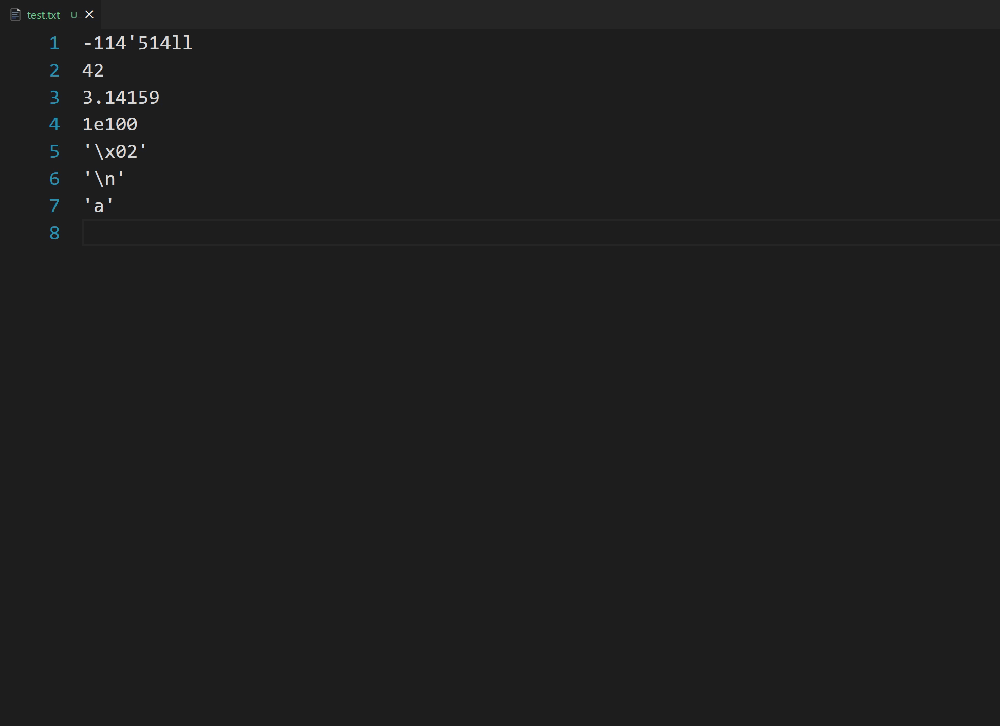

# number literal

## Overview

Shows every representation of the numeric or character literal under the cursor.
It works in any file and needs no language server.

## Samples



## Install

Build the package from a clone and install it, then reload the window:

```
python3 pack.py
code --install-extension ./number-literal-0.1.0.vsix --force
```

Only Python 3 is needed to build. With Node.js installed, `npx @vscode/vsce
package` produces the same file. `code` is the CLI of the desktop install, or the
remote CLI of a remote session
(`~/.vscode-server/bin/<commit>/bin/remote-cli/code`), which targets the window
that is already connected. Copying the folder into the extensions directory works
as well, unless VS Code has recorded this id in `<extensions dir>/.obsolete`,
where a listed folder is skipped and then deleted.

## Settings and features

| Setting | Values | Default |
| --- | --- | --- |
| `numberLiteral.width` | `64-bit`, `32-bit` | `64-bit` |
| `numberLiteral.endianness` | `LITTLE ENDIAN`, `BIG ENDIAN` | `LITTLE ENDIAN` |

Both settings are read on every hover, so a change takes effect on the next
hover without a reload. The current configuration is printed under the card as
chips, next to a link that opens the settings.

- The integer card holds `DEC-S`, `DEC-U`, `HEX`, `OCT`, `BIN`, `ASCII` (only for
  `0 < value < 128`) and `MEM`.
- The float card holds an `F32` block and an `F64` block separated by a rule; each
  block holds the fixed point, the scientific and the hexadecimal float
  representation of that width, followed by its memory sequence.
- The character card holds `DEC`, `HEX`, `OCT`, `BIN` and, for an invisible
  character, its name.
- `32-bit` drops the bits above bit 31: `-1` becomes `0xFFFFFFFF` and
  `4294967295` in unsigned decimal.
- The binary representations use four bits per group and thirty-two bits per
  line. `BIN` is the value itself, `MEM` is the same value in the byte order of
  the setting, printed as hexadecimal bytes and then as bits.
- A card is shown only for a literal that stands alone. A neighbouring word
  character, dot, quote or backslash suppresses it, while a sign directly in
  front of the literal belongs to it, so `x-1` shows `-1`.

## Supported formats

**Integers**

- decimal `123`, octal `0` / `0o`, hexadecimal `0x` / `0X`, binary `0b` / `0B`
- `\x41`, the value taken modulo 256
- `'` and `_` between digits, for example `1'000`, `0x1_F`, `0b1010_0101`
- suffix `u`, `l`, `ll`, `ul`, `lu`, `ull`, `llu`; `n`, `L`, `UL`; `u8` ... `u128`,
  `usize`, `i8` ... `i128`, `isize`; `G`, `g`, `I`, `s`, `us`, `y`, `uy`
- one `+` or `-` directly in front

**Floats**

- `1.5`, `.5`, `1.`, `1e5`, `1e-5`, `1'000.5`
- hexadecimal float `0x1.8p3`, `0x1p-3`
- suffix `f`, `F`, `d`, `D`, `l`, `L`, `f0`, `f32`, `f64`

**Characters**

- `'a'`, `'\n'`, `'\0'`, `'\\'`, `'\''`, `'\x41'`, `'\053'`
- simple escapes `a b f n r t v 0 \ ' " ?`, octal escapes of one to three digits,
  hexadecimal escapes of any length; the value is taken modulo 256
